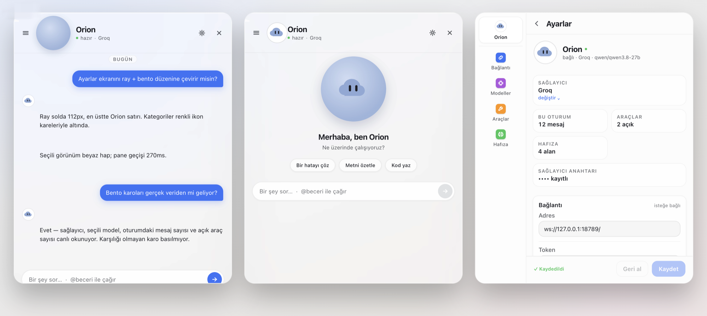

# Orion

> A personal AI desktop assistant that lives in the macOS notch, behind a pane of frosted glass.



Orion lives in the MacBook notch: a **small pill** when closed, a **light frosted-glass panel** when
open. Inside the panel lives an animated cloud character — not decoration, but a companion with a
contract: it has a fixed home in every state, it never covers the conversation, and its reactions
are governed by cooldowns.

## Highlights

- **Two modes, one window:** pill (196×36) and panel (481×600, or 701×600 with history open).
  Geometry only changes on mode transitions; all live motion is transform-only GPU work in the renderer.
- **Light vibrancy:** frosted glass over your own wallpaper, dark ink, a single blue accent.
  Text stays readable on glass (secondary ink ≥ 4.5:1).
- **Living avatar:** procedural definition (`orion.avatar.json`), a state machine (sleeping /
  listening / thinking / error…), drag-and-drop position persisted in `localStorage`, double-click
  or Enter to send it home.
- **Chat:** Markdown, typewriter pacing, a "ThoughtLine" reasoning line, day divider, glass composer.
- **Sessions:** history list, new session, switching, context carry-over when the window fills up.
- **Settings — the "Orion Rail":** Orion bento profile on top, then Connection / Models / Tools /
  Memory / General, with macOS-style grouped rows and squish switches on the right.
- **Skills:** invoke with `@skill`; MCP tool status and ping.
- **Accessibility:** full keyboard navigation, visible focus rings, `prefers-reduced-motion`
  support, aria-labelled icon buttons.

## Architecture

```
macOS notch
└── Electron (app/electron/main.js) — one BrowserWindow, two modes
    ├── CLOSED: pill (196×36)      → status text + pulse dot
    └── OPEN:   panel (481×600)    → 701×600 with sidebar
        ├── [0] .window           → glass shell (vibrancy + rim + notch shoulders)
        ├── [1] .panel-ui         → chat, composer, sidebar, settings
        └── [2] .avatar-layer     → circular avatar layer (topmost)
```

The main process resizes the window only on mode transitions; every animation runs in the renderer
on the GPU. There is no animation in the main process, and IPC channel names are stable.

| Constant | Value |
|---|---|
| `PILL` | 196 × 36 |
| `PANEL` | 481 × 600 |
| `SIDEBAR_W` | 220 |
| `WIDE` | 701 × 600 |

Full architecture, design language and frozen boundaries: [`PROJECT.md`](PROJECT.md) ·
design doc: [`docs/superpowers/specs/2026-11-15-orion-ui-redesign-design.md`](docs/superpowers/specs/2026-11-15-orion-ui-redesign-design.md).

## Getting started

Requirements: macOS, Node.js 20+, npm.

```bash
git clone https://github.com/zer0crypt02/Orion.git
cd Orion/app
npm install
npm run build:avatar   # builds the local avatar bundle from its AGPL dependency
npm start
```

> `app/renderer/vendor/avatar-web.bundle.js` is intentionally not committed; it is generated by
> `npm run build:avatar` after install (see `app/LICENSE-NOTICE.md`).

## Usage

| Action | Shortcut |
|---|---|
| Open / close the panel | Click the pill, press `Enter` or `Space` |
| Close the panel | `Esc` |
| Send a message | `Enter` in the composer |
| New chat | Type `/new` in the composer |
| Invoke a skill | `@skill-name` |
| Send the avatar home | Double-click the avatar, or press `Enter` |
| Chat history | Menu button in the header |

## Providers and keys

Orion supports two routes: **Groq** (default) and **OpenCode Zen**. API keys are entered only in
Settings → Connection and are encrypted locally with Electron `safeStorage`; no keys, `.env`
files or credentials are stored in this repository.

## Project layout

```
app/
├── electron/          main process: window, IPC, gateway, MCP, sessions, profile, skills
│   └── fnwatcher.swift  (compiled binary is not committed)
└── renderer/          vanilla ES modules + CSS (no build step)
    ├── index.html
    ├── js/            app, avatar, typewriter, thoughtline, squishswitch, confirm, sky…
    ├── styles/        tokens.css · base.css · components.css
    └── assets/        orion.avatar.json (original avatar definition)
gateway/               local gateway experiments
prototype/             early HTML prototypes
docs/                  design documents
```

The renderer deliberately uses **build-free** vanilla ES modules: no React, no Tailwind, no UI
framework. Design values come from a single source (`styles/tokens.css`); the duration palette is
120 / 270 / 450 ms with the signature curve `cubic-bezier(0.4, 0, 0.2, 1)`.

## License

**All rights reserved.** This repository is public for viewing only. Copying, modifying, creating
derivative works and redistributing require **prior written permission** — see [`LICENSE`](LICENSE).
For permission, reach out on GitHub: [@zer0crypt02](https://github.com/zer0crypt02).

Third-party components keep their own licenses; notices are in
[`app/LICENSE-NOTICE.md`](app/LICENSE-NOTICE.md).

## Credits

- [`@bible-strong/avatar-web`](https://www.npmjs.com/package/@bible-strong/avatar-web) — procedural
  avatar schema and runtime (AGPL-3.0-only, used as an npm dependency).
- Vanilla ports adapted from [React Bits](https://reactbits.dev) components (`GooeyNav`,
  `GradientASCII`), noted in each source file's header.
